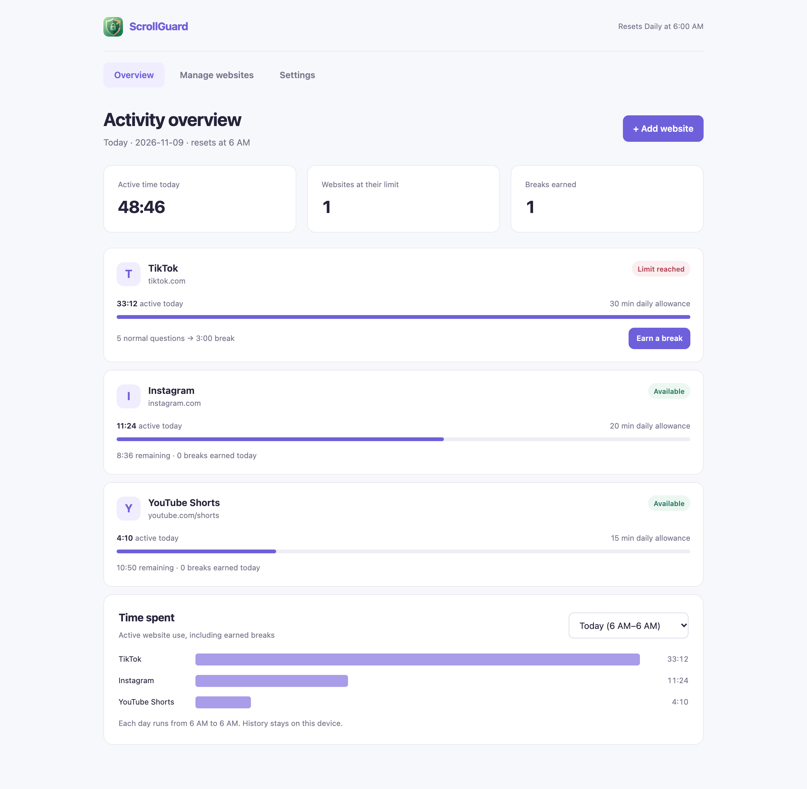
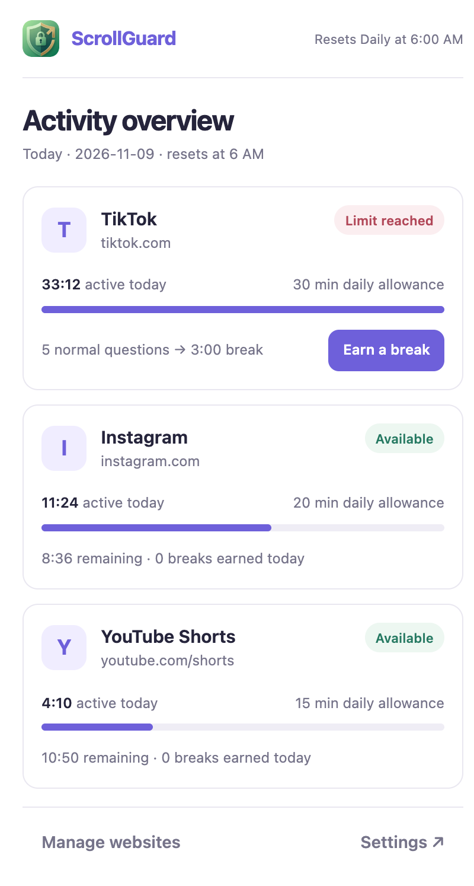
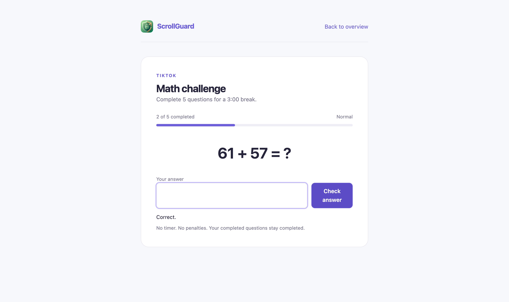
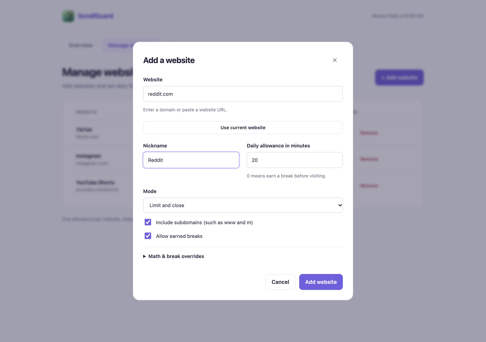
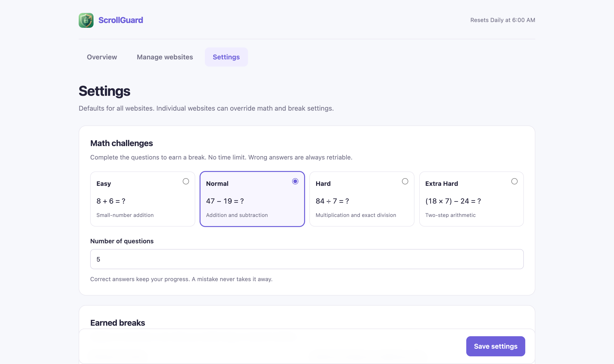

# ScrollGuard

ScrollGuard is a Chrome extension that gives websites a daily time limit. Once you use up your time on a site, it gets blocked until 6 AM the next morning. If you really need a few more minutes, you can solve some math problems to earn a short break.

<p align="center">
  
</p>

## What it does

- You choose which sites to limit (TikTok, Instagram, Reddit, anything) and how many minutes a day you get on each.
- Only time you actually spend looking at the site counts. Tabs sitting in the background don't.
- When your time runs out, the tab goes back to the page you were on before. If there wasn't one, the tab closes. You also get a notification.
- Want more time? Answer a few math questions to get a 1 to 5 minute break.
- You can limit just YouTube Shorts and still watch regular YouTube videos.
- Everything resets at 6 AM your local time.
- Your data never leaves your browser. There's no account and no server.

## Screenshots

<table>
  <tr>
    <td align="center" width="38%"><br><sub>Click the toolbar icon to see time left on each site</sub></td>
    <td align="center"><br><sub>Solve math problems to earn a break. No timer.</sub></td>
  </tr>
  <tr>
    <td align="center"><br><sub>Add any site and set its daily minutes</sub></td>
    <td align="center"><br><sub>Pick how hard the math is</sub></td>
  </tr>
</table>

## Install

You need Google Chrome 120 or newer. It works on Windows and Mac.

1. Download the **Windows** or **macOS** ZIP from the [latest release](https://github.com/RayyanHai/ScrollGuard/releases/latest).
2. Unzip it into a folder you won't move or delete.
3. Go to `chrome://extensions` and turn on **Developer mode** (top right).
4. Click **Load unpacked** and pick the folder you unzipped.
5. Pin ScrollGuard to your toolbar so it's easy to reach.

Step-by-step guides with more detail: [Windows](docs/INSTALL-windows.md) · [macOS](docs/INSTALL-macos.md)

**Updating:** replace the files in the same folder, then click **Reload** on the ScrollGuard card in `chrome://extensions`. Don't uninstall first, because that deletes your saved usage and settings.

## How to use it

1. Click the ScrollGuard icon and choose **Manage websites**.
2. Click **Add website**, type the site (like `tiktok.com`), and set your daily minutes.
3. Chrome will ask to let ScrollGuard access that site. Click **Allow** so it can track your time.
4. Browse like normal. The toolbar icon shows how many minutes you have left.
5. When a site is blocked, open the popup and click **Earn a break** if you want more time.

To limit only YouTube Shorts, type `youtube.com/shorts` when adding the site.

## Good to know

- **Wrong answer?** Just try again. There's no timer and you never lose the questions you already got right.
- **Breaks use real clock time.** Leaving the site or closing Chrome doesn't pause a break, and you can't save breaks for later.
- **Want it harder to cheat?** In Settings you can make each break need more questions, or lock your settings so changing them takes a math challenge or waits until the next 6 AM.
- **No notifications showing up?** Check that Chrome is allowed to send notifications in your system settings. The install guides above walk through it.
- **What it doesn't cover:** phone apps, the TikTok desktop app, other browsers, and other Chrome profiles. It only works in the Chrome profile you installed it in.

| Difficulty | Example |
| --- | --- |
| Easy | `8 + 6` |
| Normal | `47 − 19` |
| Hard | `84 ÷ 7` |
| Extra Hard | `(18 × 7) − 24` |

---

## For recruiters: how it's built

ScrollGuard is a Manifest V3 Chrome extension written in plain JavaScript. There's no framework, no build step, and no runtime dependencies. The extension logic is about 1,200 lines, backed by 71 unit tests and a real-browser test suite.

**Tech:** JavaScript, Chrome Extension APIs (service worker, content scripts, storage, alarms, idle, notifications, permissions), Node's built-in test runner, Playwright, GitHub Actions, Python (release packaging).

### The hard parts

**The background script can die at any moment.** Chrome shuts down extension service workers whenever it wants. So all state lives in storage under one key, and every change is saved in a single write. If the worker restarts halfway through the day, it reloads and carries on. Finishing a challenge and getting the break are saved together, so a crash can't leave you with one and not the other.

**Lots of browser events fire at once.** Switching tabs or windows can trigger several events in the same instant. Every event and message goes through one queue, so only one thing changes state at a time. For example, clicking submit twice on the last question can't give you two breaks.

**Counting time accurately.** Only the selected tab in the focused window counts. The page sends a small heartbeat about once a second while it's visible. If the heartbeats stop (laptop asleep, Chrome frozen), that gap isn't charged to you.

**A day that starts at 6 AM.** Days run 6 AM to 6 AM in your local time zone, including across daylight saving changes. If Chrome was closed at 6 AM, the reset happens the next time it starts. Breaks are stored as real clock deadlines, so restarting Chrome doesn't reset or extend them.

**Keeping permissions small.** ScrollGuard only asks for access to a site when you add it. The script that runs on websites can't read your settings or start challenges. Only the extension's own pages can do that.

**Upgrading without losing data.** Version 4 replaced an older Instagram/TikTok-only version. It imports the old limits and math settings automatically.

### Testing

- **Unit tests** cover time tracking, the 6 AM reset, daylight saving, challenge retries, double submits, recovering from a crashed worker, settings lock, and upgrades.
- **Real-browser tests** load the actual extension in Chromium with Playwright. They add sites, use up a limit, check blocking and notifications, solve challenges, restart the browser, and fast-forward the clock.
- **CI** runs the tests on Linux, macOS, and Windows for every push. Tagging a version builds the Windows and Mac ZIPs, tests them in a real browser, and publishes a GitHub release.

### Code map

| File | What it does |
| --- | --- |
| `lib/engine.js` | Core logic with no browser code: time accounting, 6 AM days, challenges, breaks |
| `lib/config.js` | Defaults, difficulty levels, input checks |
| `lib/storage.js` | Saving state and upgrading from older versions |
| `background/service-worker.js` | Handles browser events, tracking, blocking, permissions |
| `content/detector.js` | Runs on tracked sites and sends the once-a-second heartbeat |
| `lib/app.js`, `lib/ui.css` | Popup, overview, website manager, settings |
| `challenge/` | The math challenge page |

### Run it yourself

Needs Node.js 20+ (only for development).

```sh
npm test
npm run check
```

Real-browser tests (uses a throwaway Chrome profile, never your own):

```sh
npm install --no-save --package-lock=false playwright
npx playwright install chromium
node scripts/browser-smoke.js
```

Build the release ZIPs with `python scripts/package-release.py`.

## License

All rights reserved. This project is published as a portfolio piece for reference. You may not copy, modify, or redistribute the code without permission.
